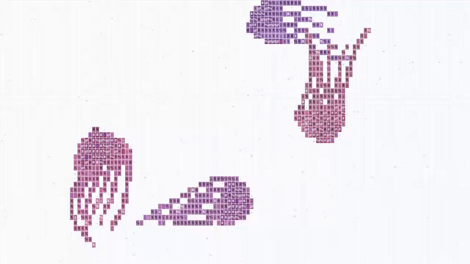

# ascii-jellyfish 🪼

> Pulsing jellyfish drifting in ASCII on HTML canvas with jet propulsion & bioluminescent glows. Zero dependencies.



Deep-sea hydrodynamics rendered in monospace ASCII characters on an HTML `<canvas>`. Featuring sinusoidal bell jet contraction, multi-node trailing tentacles, oral arms, plankton swarms, and bioluminescent glow dissipation.

Inspired by [ascii-sharks](https://github.com/stackedlol/ascii-sharks).

---

## ✨ Features

- **Bell Jet Contraction & Expansion**: Bell margin pulsates with realistic volume-preserving compression, ejecting water to propel the jellyfish upwards before gliding.
- **Multi-Node Tentacle Physics**: 18-node inverse kinematic chains with fluid drag, trailing oral arms, and delicate marginal stinging tentacles.
- **Bioluminescent Ecosystem**: Drifting ambient plankton organisms respond to pressure waves and illuminate nearby bells.
- **Species Roster**:
  - 🪼 **Moon Jellyfish** (*Aurelia aurita*) — Translucent dome with four characteristic horseshoe-shaped gonads.
  - 🪼 **Compass Jellyfish** (*Chrysaora hysoscella*) — V-shaped brown markings radiating from the apical bell dome.
  - 🪼 **Lion's Mane Jellyfish** (*Cyanea capillata*) — Massive scalloped bell with expansive, flowing oral arms.
  - 🪼 **Crystal Jellyfish** (*Aequorea victoria*) — Highly transparent, luminescent green/violet photoprotein fringe.
- **Zero Dependencies**: Pure Vanilla JS / TypeScript. Runs directly from `jellyfish.js` or via modern build tools (Vite, Next.js).
- **Responsive & Accessible**: Auto-resizes, respects `prefers-reduced-motion`, and pauses when out of view.

---

## 🚀 Quick Start

### 1. Plain HTML (Zero Build Tools)

Drop `jellyfish.js` into any web page:

```html
<!doctype html>
<html>
  <head>
    <style>
      body { margin: 0; background: #000; overflow: hidden; }
      canvas { width: 100vw; height: 100vh; font-family: monospace; }
    </style>
  </head>
  <body>
    <canvas id="abyss"></canvas>

    <script src="jellyfish.js"></script>
    <script>
      const canvas = document.getElementById("abyss");
      const engine = new JellyfishEngine(canvas);
    </script>
  </body>
</html>
```

### 2. Modern Bundlers & TypeScript (Vite / Next.js)

```bash
npm install
npm run dev
```

```typescript
import { JellyfishEngine } from "ascii-jellyfish";

const canvas = document.querySelector("canvas")!;
const engine = new JellyfishEngine(canvas, [
  { kind: "moon", size: 1.0 },
  { kind: "compass", size: 0.95 },
  { kind: "lion", size: 1.1 },
  { kind: "crystal", size: 0.85 },
]);
```

### 3. React Component

```tsx
import { AsciiJellyfish } from "ascii-jellyfish/react";

export default function DeepSea() {
  return (
    <div style={{ width: "100vw", height: "100vh", background: "#000" }}>
      <AsciiJellyfish
        jellies={[
          { kind: "moon", size: 1.0 },
          { kind: "crystal", size: 0.9 },
        ]}
      />
    </div>
  );
}
```

---

## 🕹️ Interactive Controls & URL Parameters

You can customize the simulation directly via URL search parameters:

```text
http://localhost:5173/?jellies=moon,compass,lion,crystal
```

- **Click / Tap**: Creates an acoustic compression wave that disturbs plankton and induces panic pulses in nearby bells.
- **Mouse Hover**: Jellyfish gently drift away from cursor disturbance vectors.

---

## 🧬 Biological Simulation Mechanics

1. **Jet Propulsion Cycle**: The bell contracts during the power phase ($\cos(\phi) > 0$), narrowing the margin and generating upward impulse $\vec{F} = k \cdot \hat{d}$. The relaxation phase allows elastic recoil and smooth viscous deceleration.
2. **Kinematic Tentacle Drag**: Tentacle nodes follow parent motion through damped spring relaxation ($a_{i} = (p_{i-1} - p_i) \cdot \kappa - \gamma v_i$), creating organic serpentine fluid trails.
3. **Plankton Flocking**: Passive micro-organisms drift along ocean currents and flare in luminance when excited by acoustic wakes.

---

## 📄 License

MIT © 2026 [Lazaro Guerrero Losada](https://github.com/lazaro-guerrero-losada)
